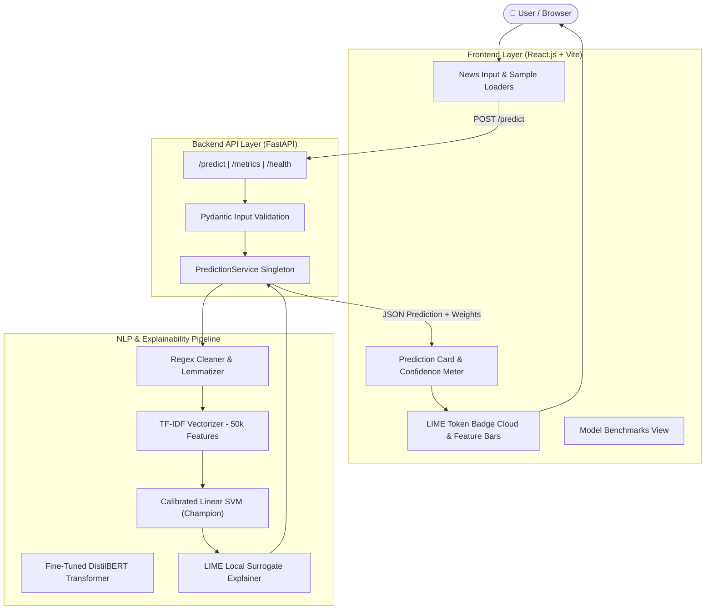

# 🛡️ TruthLens: Explainable Fake News Detection System

[](https://www.python.org/)
[](https://fastapi.tiangolo.com/)
[](https://react.dev/)
[](https://scikit-learn.org/)
[](https://huggingface.co/)
[](LICENSE)

**TruthLens** is an end-to-end Machine Learning and Natural Language Processing (NLP) web application designed to classify news articles and headlines as **Real** or **Fake** with high precision, algorithmic confidence scoring, and local token-level **explainability (LIME)**.

---

## 📐 System Architecture



---

## 🏆 Model Benchmarks & Comparison

Evaluated on a held-out test split of **5,865 news articles** (stratified 70% Train / 15% Val / 15% Test) from the Kaggle Fake and Real News dataset (~44k raw articles):

| Model Architecture | Test Accuracy | Precision | Recall | F1-Score | ROC-AUC | Latency | Serving Role |
|---|---|---|---|---|---|---|
| **Linear SVM** (Calibrated LinearSVC) | **99.47%** | **99.44%** | **99.40%** | **99.42%** | **0.9996** | **< 5ms** | 🏆 **Production Champion** |
| **DistilBERT** (`distilbert-base-uncased`) | **99.00%** | **99.45%** | 98.36% | **98.90%** | **0.9994** | ~40ms | 🧠 Deep Learning Baseline |
| **Logistic Regression** (TF-IDF) | 98.70% | 99.13% | 98.03% | 98.58% | 0.9989 | < 5ms | Classical Baseline |
| **Multinomial Naive Bayes** | 96.10% | 95.31% | 96.20% | 95.76% | 0.9921 | < 3ms | Fast Classical Baseline |

---

## ✨ Key Features

1. **Real-Time News Classification**: Instantaneous classification of news articles or headlines with confidence scores (0% to 100%).
2. **Token-Level Explainability (LIME)**: Highlights the exact words pushing the algorithm toward *Real* (e.g. institutional/attribution keywords like `reuters`, `senate`, `bipartisan`) or *Fake* (e.g. sensationalist phrasing like `shocking`, `secret`, `massive`, `mainstream`).
3. **Preset 1-Click Samples**: Built-in sample news articles allow instant testing without manual copy-pasting.
4. **Robust Input Validation**: Rejects empty or sub-10 character submissions with helpful validation error feedback.
5. **Interactive Model Benchmarking**: Integrated metrics view showing accuracy, precision, recall, F1, and confusion matrix comparisons.
6. **Dual Model Architectures**: Implements both high-speed TF-IDF + Linear SVM pipelines and deep Transformer fine-tuning via Hugging Face DistilBERT.

---

## 📂 Project Structure

```
fakenewsdetection/
├── data/
│   ├── raw/                     # Fake.csv and True.csv (~44,898 records)
│   └── processed/               # Cleaned train.csv, val.csv, test.csv
├── notebooks/
│   ├── 01_eda_and_preprocessing.ipynb
│   ├── 02_model_benchmarks.ipynb
│   └── plots/                   # Exported EDA and Confusion Matrix figures
├── src/
│   ├── data_loader.py           # Automated dataset downloader with fallbacks
│   ├── preprocessor.py          # Cleaning, stopword removal, lemmatization & splitting
│   ├── eda.py                   # Class balance, word counts & top n-grams analysis
│   ├── train_baseline.py        # TF-IDF + LR, Naive Bayes, Linear SVM training
│   ├── train_distilbert.py      # Hugging Face DistilBERT fine-tuning pipeline
│   ├── explainability.py        # LIME token attribution engine
│   ├── evaluate.py              # Metric calculations & confusion matrix generator
│   └── test_api.py              # Automated API endpoint integration tests
├── models/
│   ├── best_baseline.pkl        # Serialized Linear SVM classifier
│   ├── tfidf_vectorizer.pkl     # Fitted 50k feature TF-IDF vectorizer
│   ├── baseline_pipeline.pkl    # End-to-end inference pipeline
│   ├── baseline_metrics.json    # Baseline evaluation records
│   ├── model_comparison.json   # Full benchmark comparison data
│   └── distilbert_model/        # Fine-tuned DistilBERT weights & tokenizer
├── api/
│   ├── main.py                  # FastAPI server with CORS & routes
│   ├── schemas.py               # Pydantic request/response schemas
│   └── service.py               # Inference and explainability service singleton
├── frontend/                    # Modern React.js + Vite Web Application
│   ├── src/
│   │   ├── components/          # Navbar, NewsInput, ResultCard, ExplainabilityView, MetricsModal
│   │   ├── App.jsx
│   │   └── index.css            # Glassmorphic dark UI stylesheet
│   ├── package.json
│   └── vite.config.js
├── Dockerfile                   # Production container definition
├── render.yaml                  # Render deployment specification
├── requirements.txt             # Python ML/NLP/API dependencies
└── README.md                    # Project documentation
```

---

## 🚀 Quickstart & Local Setup

### Prerequisites
* **Python 3.11+** installed
* **Node.js 18+** and **npm** installed

### 1. Backend Setup

```bash
# Clone the repository
git clone https://github.com/your-username/fakenewsdetection.git
cd fakenewsdetection

# Create and activate virtual environment
python -m venv .venv
# On Windows:
.\.venv\Scripts\activate
# On macOS/Linux:
source .venv/bin/activate

# Install dependencies
pip install -r requirements.txt

# Run dataset download & preprocessing (if starting from scratch)
python -m src.preprocessor

# Train baseline models (generates models/baseline_pipeline.pkl)
python -m src.train_baseline

# Start FastAPI server
uvicorn api.main:app --host 127.0.0.1 --port 8000 --reload
```
The API is now live at `http://127.0.0.1:8000` with interactive Swagger docs at `http://127.0.0.1:8000/docs`.

### 2. Frontend Setup

In a new terminal window:
```bash
cd frontend

# Install Node dependencies
npm install

# Start Vite dev server
npm run dev
```
Open your browser at `http://localhost:5173`.

---

## 📡 API Endpoints Reference

### `POST /predict`
Evaluates news authenticity and extracts top influential tokens.

**Request Body**:
```json
{
  "text": "WASHINGTON (Reuters) - The U.S. Senate passed a bipartisan spending bill on Thursday...",
  "num_explanation_words": 8
}
```

**Response Body**:
```json
{
  "label": "Real",
  "confidence_score": 100.0,
  "probabilities": {
    "Real": 1.0,
    "Fake": 0.0
  },
  "top_influential_words": [
    { "word": "reuters", "weight": -0.1896, "supports": "Real", "importance": 0.1896 },
    { "word": "thursday", "weight": -0.0936, "supports": "Real", "importance": 0.0936 },
    { "word": "washington", "weight": -0.0828, "supports": "Real", "importance": 0.0828 },
    { "word": "senate", "weight": -0.0469, "supports": "Real", "importance": 0.0469 }
  ]
}
```

### `GET /metrics`
Returns test benchmark figures and confusion matrix data across all models.

### `GET /health`
Returns system health status and model readiness.

---

## 🌐 Deployment Guide

### Production readiness checklist

1. Install backend runtime dependencies with `pip install -r requirements.txt` and verify `GET /health` returns `healthy`.
2. Install frontend dependencies from `frontend/` and run `npm run build`.
3. Deploy the backend with the included `render.yaml` or `Dockerfile`.
4. For a direct frontend-to-backend connection, set `VITE_API_BASE_URL` to the deployed API URL and set `ALLOWED_ORIGINS` on the API to the deployed frontend origin. The default `/api` path uses the included Vercel rewrite.
5. Run the integration tests with `pip install -r requirements-dev.txt` followed by `pytest -q`.

The API uses bounded in-memory protections by default: 60 requests per IP per 60 seconds,
five-minute inference cache entries, and 256 cached responses. Tune these with
`RATE_LIMIT_REQUESTS`, `RATE_LIMIT_WINDOW_SECONDS`, `PREDICTION_CACHE_TTL_SECONDS`, and
`PREDICTION_CACHE_MAX_ENTRIES`. These limits reset when a process restarts; use a shared
Redis-backed limiter/cache when running multiple backend instances.

### Deploy Backend (Render / Hugging Face Spaces)
1. Push this repository to GitHub.
2. In [Render Dashboard](https://dashboard.render.com), click **New +** &rarr; **Blueprint** and connect your repository (or create a **Web Service** with Python environment).
3. Set build command: `pip install -r requirements.txt && python -c "import nltk; nltk.download('stopwords'); nltk.download('wordnet'); nltk.download('omw-1.4'); nltk.download('punkt')"`
4. Set start command: `uvicorn api.main:app --host 0.0.0.0 --port $PORT`

### Deploy Frontend (Vercel)
1. In [Vercel Dashboard](https://vercel.com), click **Add New Project** and select the repository.
2. Set **Root Directory** to `frontend`.
3. Set Framework Preset to **Vite**.
4. Update `frontend/vercel.json` with your deployed Render backend URL and deploy.

---

## ⚠️ Ethical Considerations & Limitations
* **Assistive Tool**: TruthLens is intended as an assistive verification signal for researchers, students, and readers—not as an absolute arbiter of fact.
* **Domain Context**: Trained predominantly on English political and general news. Out-of-distribution domain shifts may affect confidence calibration.

---

## 📄 License
This project is licensed under the MIT License.
